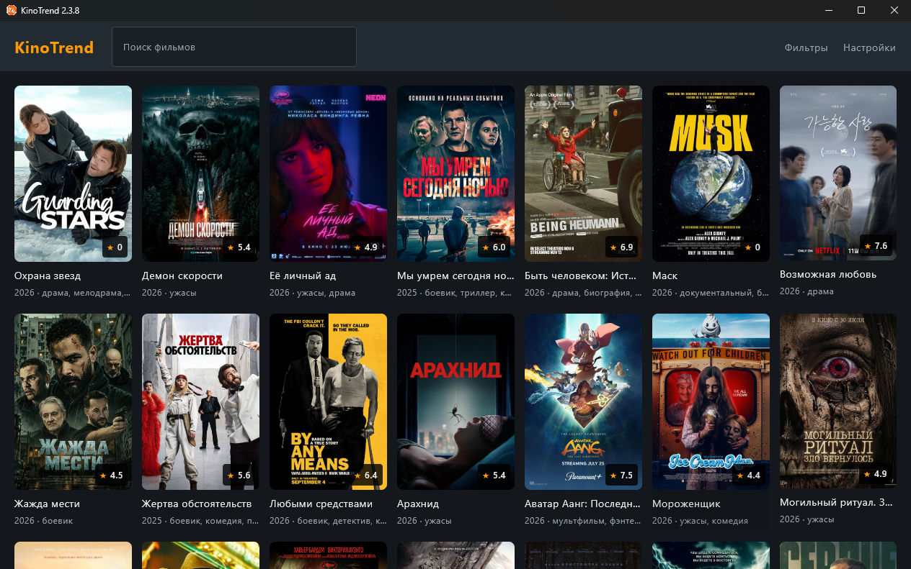

# KinoTrend Desktop 2.3.8

Неофициальная десктопная версия KinoTrend для Windows: каталог фильмов, карточки,
раздачи, TorrServer и внешние плееры. Написана на Kotlin + Compose Desktop.



## Скачать

Готовый установщик: [KinoTrend-Setup-2.3.8.exe](https://github.com/flash72i/KinoTrend-Desktop/releases/latest).

Установка персональная, в `%LOCALAPPDATA%\Programs\KinoTrend`, без прав администратора.
В установщике есть отдельный портативный режим: программа распаковывается рядом
с установщиком, данные лежат в `KinoTrend\data`.

## Возможности

- каталог KinoTrend с поиском, жанрами, странами и рейтингом;
- карточка фильма с постерами, описанием, трейлером и раздачами;
- запуск раздач через локальный TorrServer и внешний плеер;
- список плееров, выбор плеера при запуске и «Больше не спрашивать»;
- копирование magnet-ссылки в буфер обмена;
- встроенный JavaFX-плеер для HLS-трейлеров;
- тёмная тема, настройки каталога и раздач, портативный режим.

## Сборка приложения

Нужен JDK 21 и Windows.

```powershell
cd desktop
$env:JAVA_HOME = 'C:\path\to\jdk-21'
.\gradlew.bat createDistributable
```

Готовое приложение появится в `desktop\build\compose\binaries\main\app\KinoTrend`.

## Сборка установщика

1. Соберите приложение командой выше.
2. Скачайте TorrServer MatriX.150:
   <https://github.com/YouROK/TorrServer/releases/tag/MatriX.150>
   и положите `TorrServer-windows-amd64.exe` как
   `tools\torrserver\TorrServer.exe`.
3. Соберите установщик:

```powershell
powershell -ExecutionPolicy Bypass -File installer\src\build.ps1
```

Результат: `build\dist\KinoTrend-Setup-2.3.8.exe`.

Скрипт установщика использует `csc.exe` из .NET Framework 4.x. Ключ `-Admin`
собирает вариант с манифестом `requireAdministrator`; по умолчанию используется
`asInvoker` и установка в профиль пользователя.

## Структура

```
desktop/          Kotlin + Compose Desktop
  src/main/       приложение
  src/test/       ручные проверки и стенды
installer/src/    установщик на C# (WinForms/GDI+)
docs/             отчёт по APK и аудит производительности
tools/            сюда кладётся TorrServer.exe для сборки установщика
```

## Проверки

```powershell
cd desktop
.\gradlew.bat compileKotlin compileTestKotlin
```

Ручные стенды находятся в `desktop\src\test\kotlin\app\kinotrend\desktop\bench`.
`WatchBench` и `TimeoutCheck` запускаются только с `KINOTREND_BENCH=1`, потому что
поднимают TorrServer и используют сеть.

## Сторонние компоненты

Список лицензий — в [THIRD-PARTY-NOTICES.md](THIRD-PARTY-NOTICES.md).
